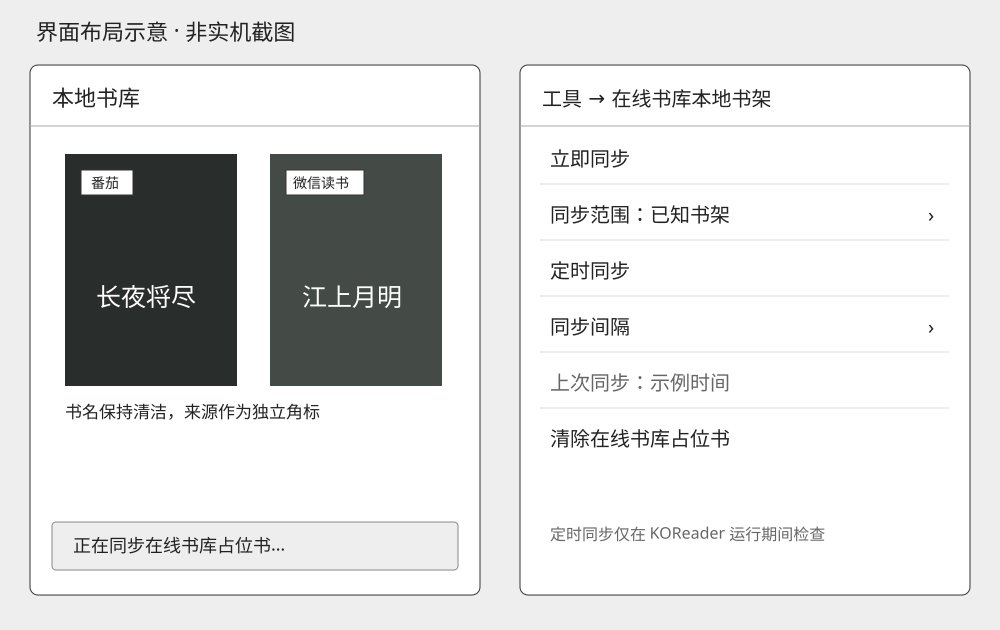

# 界面布局示意

以下为原创 SVG 示意图，用于说明交互和层级，**不是实机截图**。实际尺寸、字体和
标签布局随设备及 SimpleUI / Cover browser 版本变化。完整 UI 验收仍在进行。

- 书架封面左上角的来源标签单独绘制，不写入图片。
- 设置集中在“工具 → 在线书库本地书架”二级菜单。
- “同步范围”可选择已知书架或仅已缓存，默认是已知书架。
- 同步及打开进度通知出现在底部。
- 无法进入来源插件时，HTML 占位页保留格式化详情。

真实封面渲染样张见 [README](../README.md#默认封面预览)。
